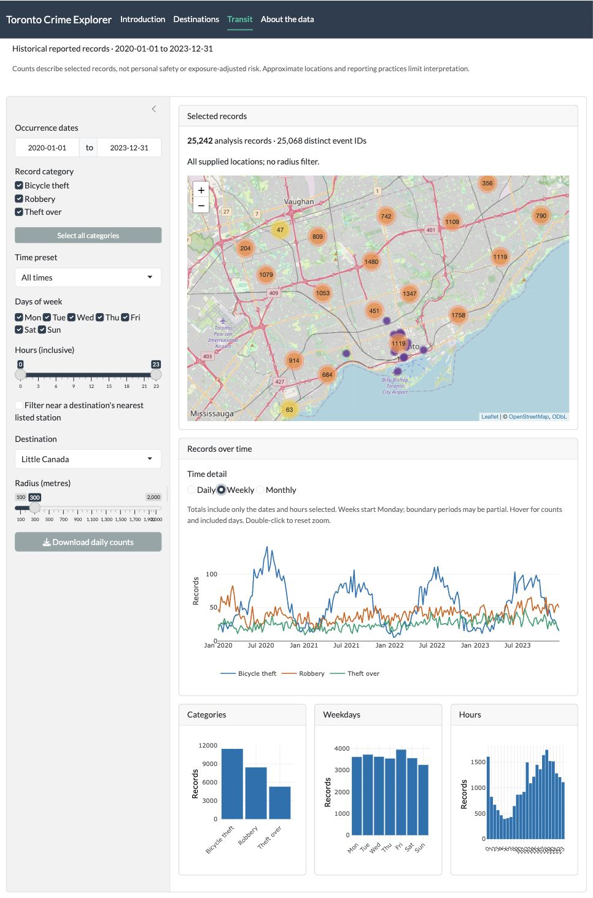

# Toronto Crime Explorer

An R/Shiny explorer for historical Toronto bicycle-theft, robbery, and theft-over records. Explore consistent temporal and spatial filters across maps, daily trends, category counts, weekday counts, and hourly counts.

**Status:** Source preview. Generated datasets are excluded from Git. No open-source license has been granted; contribution and data-source permissions remain documented as unresolved. See [PROVENANCE.md](PROVENANCE.md) and [VALIDATION.md](VALIDATION.md).

## Features

- One shared analytical pipeline for all maps, summaries, and charts.
- Destination-radius filtering and calculated nearest **listed** station selection.
- Explicit date range, crime categories, weekday/hour filters, and corrected time presets.
- Actual coverage displayed from the supplied data: January 2020–December 2023.
- Analysis-record counts alongside distinct event IDs; zero-filled eligible dates.
- Downloadable daily aggregates with filter context.
- Introduction page with guided navigation.
- Automatic OpenStreetMap basemaps with attribution on both maps.
- Weekly trends by default, with daily/monthly detail, unified hover, and zoom.

## Run locally

Run all commands from this directory. R 4.1 or newer is required; the analytical checks were run using R 4.5.3.

For this delivered workspace, Shiny was installed in an isolated task library. Launch with:

```sh
Rscript scripts/run_app.R
```

Open the loopback URL printed in the terminal. This launcher discovers the adjacent task library when available; on another machine, install the dependencies below or set `TORONTO_R_LIBRARY`. No global R library was modified.

Check dependencies:

```sh
Rscript scripts/check_environment.R
```

If missing, install the packages declared in `DESCRIPTION` into your preferred R library:

```r
install.packages(c("shiny", "bslib", "leaflet", "plotly", "ggplot2", "data.table"))
```

The local delivered working copy includes a prepared `data/processed/crime.rds`. This generated file is ignored by Git because data redistribution terms remain unverified. A fresh source checkout must rebuild it from the three original CSVs:

```sh
Rscript scripts/build_data.R /absolute/path/to/source/data
Rscripttests/test_analysis.R
Rscript -e 'shiny::runApp(".", host = "127.0.0.1", launch.browser = TRUE)'
```

`TORONTO_CRIME_DATA` can override the prepared RDS path. Only load trusted RDS files. No API credentials are configured. Tile requests occur automatically in the browser when a map is viewed; a usable internet connection is needed for the basemap, not for filtering local data.

## Preview



## Analytical definitions

- **Analysis record:** a unique row across event ID, occurrence date/hour, category, coordinates, status, location type, and premises type. This is not automatically an incident, offense, victim, or bicycle count. Multiple records may share an event ID. The UI separately reports distinct IDs.
- **Bicycle theft:** all statuses are retained, including recovered and unknown. This differs deliberately from the recovered application's stolen-only subset.
- **Date coverage:** valid occurrence dates from 2020 onward in the supplied snapshots. No synthetic 2024 records are created. Controls derive their range from actual data.
- **Peak:** Monday–Friday 06:00–08:59 and 15:00–18:59. Off-peak is the exact complement, including overnight hours and weekends.
- **Midterm preset:** February and October. **Final preset:** April and December. These are illustrative presets, not verified university calendars.
- **Break preset:** June–August plus December 23–January 3.
- All presets intersect the date, weekday, and hour controls. Excluded dates remain gaps in the daily chart; eligible dates with no records display zero.
- **Distance:** spherical great-circle distance in metres, not walking distance. Station selection searches only the 11 recovered listed stations, not the complete TTC network.
- The broad coordinate plausibility box (longitude -80 to -78; latitude 43 to 45) rejects obviously implausible locations but is not a Toronto-boundary containment test.
- Counts are not adjusted for population, ridership, foot traffic, reporting rates, or location uncertainty. Do not interpret them as individual safety predictions.

## Structure

```text
app.R                    Application entry point and navigation
R/analysis.R             Pure filtering, date rules, distance, aggregation, validation
R/explorer.R             Reusable Shiny explorer module
config/places.csv        15 recovered destinations
config/stations.csv      11 distinct recovered stations
scripts/build_data.R     Validated offline CSV-to-RDS build and source checksums
scripts/check_environment.R
scripts/run_app.R         Local launcher with optional isolated library
tests/test_analysis.R   Base-R regression checks and optional real-data checks
data/processed/         Local generated data; excluded from version control
.github/workflows/       Synthetic-data analytical CI checks
```

## Development and publication

Run `Rscripttests/test_analysis.R` after changes. CI runs synthetic analytical checks without requiring private/local CSVs or package installations. It does not perform browser tests or certify deployment readiness.

The source repository is https://github.com/KaiwenYangUT/toronto-crime-explorer. The hosted Shiny application has not been deployed. Before public release, confirm contributor permissions, dataset sources and terms, map-provider suitability, and the intended code license. Then capture a complete tested dependency environment (for example using renv), extend browser validation to mobile layouts and live basemap services. `DEPENDENCIES.csv` records the tested package versions (including transitive dependencies); it is not an automated restore lockfile.

## Contributions

Kevin Yang describes originating the concept, designing the application, making principal technical decisions, and implementing the project. A friend also contributed implementation and ran the app. This copy was recovered from that friend's laptop after Kevin's copy was lost. The modernization was carried out with Codex assistance. See [PROVENANCE.md](PROVENANCE.md) for the distinction between this account and independently recoverable evidence.
